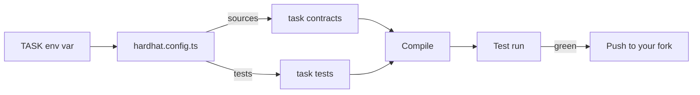

<p align="center">
  <a href="https://redduck.io">
    <picture>
      <source media="(prefers-color-scheme: dark)" srcset=".github/assets/redduck-logo-dark.svg">
      
    </picture>
  </a>
</p>

<h1 align="center">RedDuck Academy — Solidity Template</h1>

<p align="center">
  <b>Six Solidity tasks, one Hardhat config, one task compiled at a time.</b>
</p>

---

A Solidity learning template by [RedDuck](https://redduck.io). Fork it, work through the tasks, push your work. Each task is a self-contained folder with its own brief, contracts and tests, and only one of them is compiled and tested at a time, so an unfinished task never blocks the next one.

## Built with

| Area | Technology |
| --- | --- |
| Contracts | Solidity 0.8.28, optimizer on (200 runs) |
| Build & test | [Hardhat 3](https://hardhat.org/) with `hardhat-toolbox-viem` |
| Test client | [viem](https://viem.sh/), EDR-simulated L1 network |
| Task libraries | [OpenZeppelin Contracts](https://www.openzeppelin.com/contracts), [Chainlink Contracts](https://docs.chain.link/) |
| Quality | [solhint](https://protofire.github.io/solhint/), Prettier + `prettier-plugin-solidity` |
| Runtime | Node.js 22+ (see `.nvmrc`), npm, TypeScript |

## How it works



One config serves the whole repo. `TASK` picks which folder Hardhat treats as the project — sources, tests, cache and artifacts all resolve under it, defaulting to `01-token`. The `npm run test:<task>` scripts just set that variable for you.

```
.
├── hardhat.config.ts        # one config for the whole repo
├── package.json
├── tsconfig.json
└── 01-token/                # current task
    ├── TASK.md              # brief — read this first
    ├── contracts/           # Solidity sources (edit these)
    └── tests/               # test suite
```

## Tasks

Read the task's `TASK.md` before you start — it explains what to build and links to anything else you need.

| # | Task | What you build |
| --- | --- | --- |
| 01 | [`01-token`](01-token/) | Token |
| 02 | [`02-price-voting`](02-price-voting/) | PriceVoting contract |
| 03 | [`03-price-voting-withdrawal`](03-price-voting-withdrawal/) | PriceVoting with mid-voting withdrawal |
| 04 | [`04-amm-pair`](04-amm-pair/) | Constant-product AMM pair |
| 05 | [`05-merkle-airdrop`](05-merkle-airdrop/) | Merkle airdrop with signature-based claims |
| 06 | [`06-raffle`](06-raffle/) | Chainlink raffle |

## Getting started

Prerequisites: Node.js 22+ (see `.nvmrc`) and npm.

```bash
npm install
npm run compile:01-token
npm run test:01-token
```

Or pick a task with the `TASK` env var:

```bash
TASK=01-token npm test
TASK=01-token npm run coverage
```

Repo-wide helpers:

```bash
npm run lint:sol      # solhint over all tasks
npm run format:fix    # prettier over the repo
```

## Workflow per task

1. Open the task folder and read `TASK.md` — it explains what to build and links to anything else you need.
2. Implement the contract in `contracts/`.
3. Write tests in `tests/` if the task asks you to. Early tasks ship with the test suite pre-defined; later capstones require you to write your own.
4. Run `npm run test:<task>` until everything passes.
5. Commit and push to your fork.

## Rules

- Don't change function signatures, event signatures, or custom error names in task contracts unless asked to. The tests and the reviewer match on them.
- Don't modify pre-defined test files. If a task asks you to write tests, add new ones; don't edit the existing spec.
- Don't copy implementations from OpenZeppelin, Solmate, Solady, or tutorials. See the per-task `TASK.md` for the full reasoning.

## License

[MIT](LICENSE)
